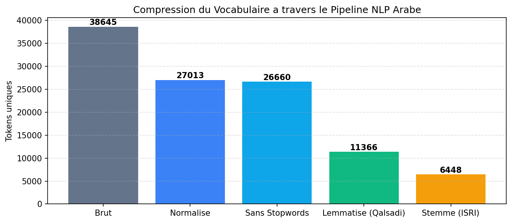
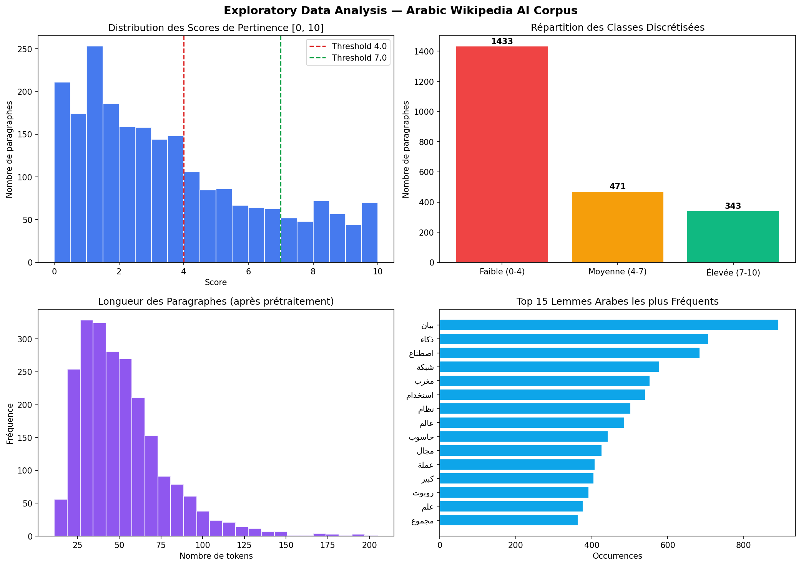
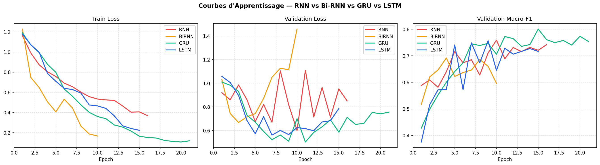
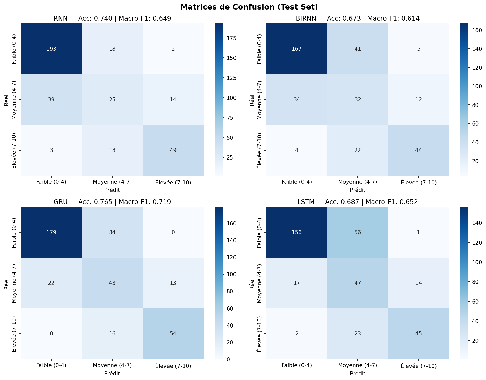
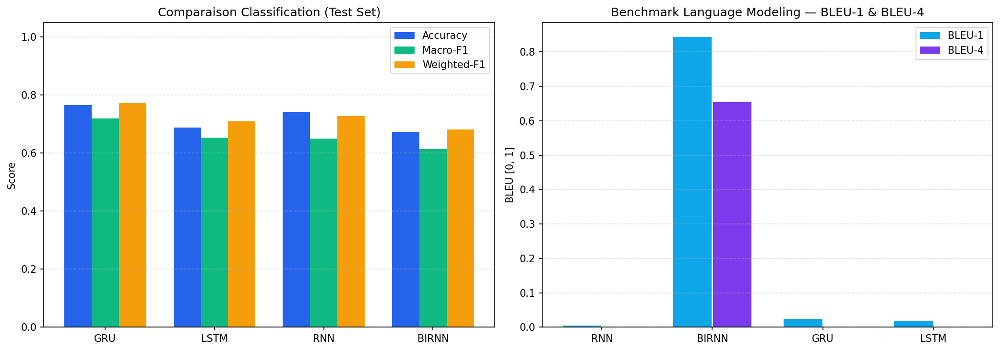
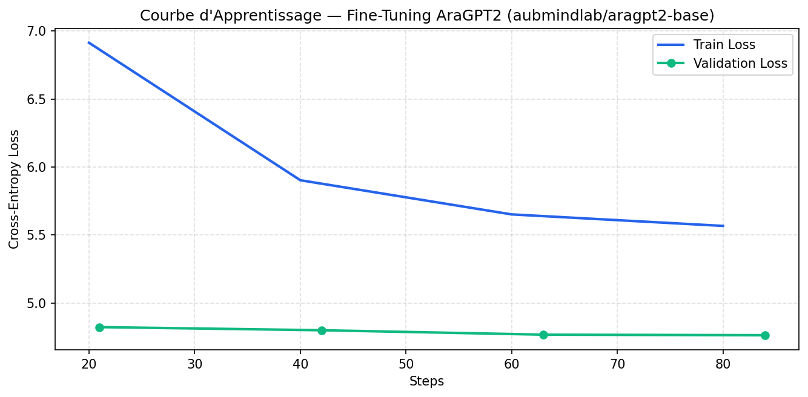

# FST Tanger — CI-LSI (Cycle d'Ingénieur) — Deep Learning : Lab 3 (Arabic NLP en PyTorch & Fine-Tuning AraGPT2)

[](https://www.python.org/)
[](https://pytorch.org/)
[](https://huggingface.co/aubmindlab/aragpt2-base)
[](https://colab.research.google.com/github/yassinekamouss/fstt-dl-lab3-nlp-pytorch/blob/main/notebooks/01_scraping_and_dataset.ipynb)

> **Université Abdelmalek Essaadi — Faculté des Sciences et Techniques de Tanger (FSTT)**  
> **Département Génie Informatique — Cycle d'Ingénieur (CI-LSI) — Deep Learning (Atelier 3 / Lab 3)**  
> **Encadrant :** Pr. Elaachak Lotfi  
> **Dépôt GitHub :** [`yassinekamouss/fstt-dl-lab3-nlp-pytorch`](https://github.com/yassinekamouss/fstt-dl-lab3-nlp-pytorch)

Ce projet implémente de bout en bout un pipeline complet de **Traitement Automatique du Langage Naturel (NLP) pour la langue arabe** en PyTorch et Hugging Face Transformers, exécuté sur Google Colab (GPU T4) à partir de données collectées sur **Wikipédia en arabe (`ar.wikipedia.org`)** autour de la thématique **الذكاء الاصطناعي (Intelligence Artificielle)**.

---

## Table des Matières

1. [Résumé Exécutif — Résultats Clés](#résumé-exécutif--résultats-clés)
2. [Notebooks Exécutés (GitHub & Google Colab)](#notebooks-exécutés-github--google-colab)
3. [Architecture du Dépôt](#architecture-du-dépôt)
4. [Partie 1A — Scraping Wikipédia Arabe, Scoring `[0, 10]` & Pipeline NLP](#partie-1a--scraping-wikipédia-arabe-scoring-0-10--pipeline-nlp)
5. [Partie 1B — Classification PyTorch (`RNN`, `Bi-RNN`, `GRU`, `LSTM`) & Tuning Optuna](#partie-1b--classification-pytorch-rnn-bi-rnn-gru-lstm--tuning-optuna)
6. [Partie 1C — Benchmark Language Modeling & Score BLEU](#partie-1c--benchmark-language-modeling--score-bleu)
7. [Partie 2 — Fine-Tuning Transformer (`aubmindlab/aragpt2-base`) & Génération de Texte](#partie-2--fine-tuning-transformer-aubmindlabaragpt2-base--génération-de-texte)
8. [Synthèse Finale & Enseignements Clés](#synthèse-finale--enseignements-clés)
9. [Reproduction (Colab & Local)](#reproduction-colab--local)

---

## Résumé Exécutif — Résultats Clés

| Dimension | Résultat Obtenu | Détail Principal |
| :--- | :--- | :--- |
| **Corpus Wikipédia Arabe** | **2 247 paragraphes** (`49` articles uniques) | 3 niveaux (`core`: 683, `related`: 714, `off_topic`: 850) — moy. `74.2` mots/paragraphe |
| **Pipeline NLP Arabe** | **`38 645` → `11 366` lemmes (`-70.6 %`)** | Normalisation `PyArabic` + stop-words + lemmatisation `Qalsadi` (`5 112` tokens en vocabulaire `train`) |
| **Split Anti-Leakage** | **0 article partagé** entre splits | `Train`: 1 493 (41 art.) · `Val`: 393 (5 art.) · `Test`: 361 (3 art.) |
| **Meilleur Classifieur (Partie 1)** | **`GRU`** (`716 867` paramètres) | **Accuracy `76.45 %`**, **Macro-F1 `0.7187`**, **Weighted-F1 `0.7717`**, **ROC-AUC `0.8973`**, **0 confusion extrême** |
| **Meilleur LM Causal (Partie 1)** | **`LSTM`** (PPL) & **`GRU`** (BLEU) | `LSTM` Test PPL **`1 145.87`** · `GRU` BLEU-1 **`0.0249`** / SacreBLEU **`0.1425`** |
| **Transformer (Partie 2 — AraGPT2)** | **`aubmindlab/aragpt2-base`** (FP16 T4) | Perplexité ~**12× inférieure** aux RNNs (`90.68` / `108.66`) · **+84.3 % SacreBLEU** après fine-tuning (`0.1431 → 0.2638`) |

---

## Notebooks Exécutés (GitHub & Google Colab)

Les trois notebooks incluent toutes leurs sorties d'exécution (tableaux, graphiques et textes arabes générés) directement sur GitHub :

| Étape | Notebook | Rôle dans le Pipeline | Lien Colab |
| :---: | :--- | :--- | :--- |
| **01** | [`01_scraping_and_dataset.ipynb`](notebooks/01_scraping_and_dataset.ipynb) | Scraping Wikipédia Arabe (`BeautifulSoup4`), calcul du score `[0, 10]`, préprocessing NLP, EDA & split groupé | [](https://colab.research.google.com/github/yassinekamouss/fstt-dl-lab3-nlp-pytorch/blob/main/notebooks/01_scraping_and_dataset.ipynb) |
| **02** | [`02_part1_sequence_models.ipynb`](notebooks/02_part1_sequence_models.ipynb) | Architectures `RNN`, `Bi-RNN`, `GRU`, `LSTM`, tuning Optuna, évaluation classification & benchmark LM/BLEU | [](https://colab.research.google.com/github/yassinekamouss/fstt-dl-lab3-nlp-pytorch/blob/main/notebooks/02_part1_sequence_models.ipynb) |
| **03** | [`03_part2_gpt2_finetuning.ipynb`](notebooks/03_part2_gpt2_finetuning.ipynb) | Fine-tuning de `aubmindlab/aragpt2-base` sur GPU T4, comparaison Avant/Après & décodage Greedy / Beam / Nucleus | [](https://colab.research.google.com/github/yassinekamouss/fstt-dl-lab3-nlp-pytorch/blob/main/notebooks/03_part2_gpt2_finetuning.ipynb) |

---

## Architecture du Dépôt

```text
fstt-dl-lab3-nlp-pytorch/
├── configs/
│   └── config.yaml                      # Configuration centrale (sujet AR, lexique, hyperparamètres, seeds)
├── src/
│   ├── colab_utils.py                   # Détection Colab/local, montage Google Drive, seed_everything, GPU info
│   ├── scraper.py                       # ArabicWikipediaScraper (BeautifulSoup4) + scoring continu [0, 10]
│   ├── preprocessing.py                 # Normalisation PyArabic, stop-words, ISRI/Snowball/Qalsadi, split groupé
│   ├── dataset.py                       # Vocabulary (fit sur train), Datasets & DataLoaders (causal & cloze)
│   ├── models.py                        # SequenceClassifier & SequenceLanguageModel (RNN, Bi-RNN, GRU, LSTM)
│   ├── trainer.py                       # AdamW, EarlyStopping, tuning Optuna, benchmark LM & BLEU
│   ├── metrics.py                       # Classification metrics, BLEU/SacreBLEU, ROUGE arabe, Distinct-1/2, plots
│   └── gpt2_utils.py                    # Chargement AraGPT2, Trainer v4/v5-safe, perplexité & décodage multi-stratégies
├── notebooks/
│   ├── 01_scraping_and_dataset.ipynb
│   ├── 02_part1_sequence_models.ipynb
│   └── 03_part2_gpt2_finetuning.ipynb
├── tests/
│   └── test_local_pipeline.py           # Tests unitaires locaux (parser HTML, normalisation arabe, ROUGE arabe)
├── data/
│   ├── raw/                             # arabic_wiki_raw.csv, dataset_text_score.csv (format exact Text | Score)
│   └── processed/                       # train.csv, val.csv, test.csv, vocab.json, gpt2_corpus*.txt
├── outputs/
│   ├── figures/                         # 6 figures haute résolution générées sur Colab
│   └── reports/                         # metrics_part1.json, metrics_part2.json, tuning_results.csv, etc.
├── requirements.txt
└── README.md
```

---

## Partie 1A — Scraping Wikipédia Arabe, Scoring `[0, 10]` & Pipeline NLP

### 1. Collecte multi-niveaux et format `Text | Score`

Afin d'obtenir des textes couvrant l'intégralité de l'échelle de pertinence **`[0, 10]`**, le scraper `ArabicWikipediaScraper` (`src/scraper.py`) extrait les paragraphes propres (`<p>`, après suppression des infoboxes, tables, références `[1]` et formules mathématiques via `BeautifulSoup4`) selon 3 niveaux thématiques autour de **الذكاء الاصطناعي** :

| Niveau (`tier`) | Thématiques ciblées | Paragraphes | Score Min | Score Max | Score Moyen |
| :--- | :--- | :---: | :---: | :---: | :---: |
| **`core`** | الذكاء الاصطناعي، تعلم الآلة، التعلم العميق، الشبكات العصبية، معالجة اللغات... | **683** | 2.0 | 10.0 | **6.71** |
| **`related`** | علم البيانات، البيانات الضخمة، الخوارزميات، الإحصاء، الروبوتية، الحوسبة... | **714** | 1.0 | 9.0 | **3.36** |
| **`off_topic`** | تاريخ المغرب، طنجة، كرة القدم، الأدب العربي، علم الفلك، الجغرافيا... | **850** | 0.0 | 5.3 | **1.15** |
| **Total** | **49 articles uniques** (longueur de `25` à `287` mots, moy. **`74.2`**) | **2 247** | **0.0** | **10.0** | **3.54** |

Le score continu `[0.0, 10.0]` combine la similarité cosinus TF-IDF (leave-one-out contre le centroïde `core`), la densité dans le lexique métier arabe (`55` termes IA) et un a priori borné par niveau.

**Exemples réels extraits du fichier `data/raw/dataset_text_score.csv` (`Text | Score`) :**

| Article (`tier`) | Extrait `Text` (Arabe) | `Score` |
| :--- | :--- | :---: |
| الذكاء الاصطناعي (`core`) | الذَّكَاءُ الْاِصْطِنَاعِيُّ أو الذَّكَاءُ الصِّنَاعِيُّ ... هو قدرة الأنظمة الحاسوبية على أداء المهام التي تتطلب عادة ذكاءً بشريًا مثل التعلم والاستدلال... | **10.0** |
| علم البيانات (`related`) | علم البيانات علم يغلب عليه تداخل الاختصاصات والذي يقوم على استخدام الأساليب العلمية، والمعالجات والخوارزميات والنظم لاستخراج المعرفة... | **6.0** |
| المغرب (`off_topic`) | المَغْرِبُ (رسميًّا: المَمْلَكَةُ المَغْرِبِيَّةُ) هي دولة ذات سيادة تقع في أقصى غرب شمال إفريقيا، وتطل شمالًا على البحر المتوسط... | **0.6** |

---

### 2. Pipeline de préprocessing NLP Arabe (`src/preprocessing.py`)

Les étapes suivantes sont appliquées séquentiellement : normalisation orthographique et suppression des diacritiques/*tatweel* (`PyArabic`), tokenization arabe, filtrage des stop-words (`NLTK` + termes Wikipédia normalisés), puis comparaison entre stemming (`ISRIStemmer`, `SnowballStemmer`) et **lemmatisation (`Qalsadi`)** retenue pour préserver la lisibilité sémantique tout en réduisant la sparsité.

| Étape du Pipeline | Tokens Uniques | Réduction vs. Brut |
| :--- | :---: | :---: |
| **Texte brut** | 38 645 | — |
| **Après normalisation (`PyArabic`)** | 27 013 | `-30.1 %` |
| **Après suppression des stop-words** | 26 660 | `-31.0 %` |
| **Après lemmatisation (`Qalsadi`)** *(retenu)* | **11 366** | **`-70.6 %`** |
| **Après stemming (`ISRIStemmer`)** | 6 448 | `-83.3 %` |
| **Vocabulaire final PyTorch (`train`, `min_freq=2`)** | **5 112** | — |



---

### 3. Discrétisation, EDA & Split Anti-Leakage

Les scores continus sont discrétisés en 3 classes (`Faible [0-4[` : **1 433**, `Moyenne [4-7[` : **471**, `Élevée [7-10]` : **343**). Pour empêcher toute fuite de données entre paragraphes issus d'une même page Wikipédia, la fonction `stratified_group_split` sépare les données par **titre d'article (`title`)** :

| Split | Paragraphes | Articles Uniques | `Faible (0-4)` | `Moyenne (4-7)` | `Élevée (7-10)` |
| :--- | :---: | :---: | :---: | :---: | :---: |
| **`train`** | **1 493** (`66.4 %`) | **41** | 966 | 323 | 204 |
| **`val`** | **393** (`17.5 %`) | **5** | 254 | 70 | 69 |
| **`test`** | **361** (`16.1 %`) | **3** | 213 | 78 | 70 |
| **Total** | **2 247** (`100 %`) | **49** *(intersection = ∅)* | **1 433** | **471** | **343** |



---

## Partie 1B — Classification PyTorch (`RNN`, `Bi-RNN`, `GRU`, `LSTM`) & Tuning Optuna

### 1. Hyperparamètres optimisés via Optuna (`outputs/reports/best_hyperparams.json`)

Six essais par architecture (`Optuna TPESampler`) ont optimisé le **Macro-F1 validation** sur l'espace `(embedding_dim, hidden_dim, num_layers, dropout, lr, batch_size, pooling)` :

| Modèle | `embedding_dim` | `hidden_dim` | `num_layers` | `dropout` | `lr` | `batch_size` | `pooling` | Best Val F1 (Tuning) |
| :--- | :---: | :---: | :---: | :---: | :---: | :---: | :--- | :---: |
| **`RNN`** | 64 | 256 | 2 | 0.5 | `1.46e-3` | 32 | `mean_max` | 0.7426 |
| **`Bi-RNN`** | 192 | 256 | 2 | 0.2 | `2.93e-3` | 32 | `mean` | 0.7136 |
| **`GRU`** | 128 | 64 | 2 | 0.4 | `1.78e-3` | 64 | `last` | **0.7728** |
| **`LSTM`** | 128 | 64 | 2 | 0.4 | `1.78e-3` | 64 | `last` | 0.7568 |

---

### 2. Performance globale sur le jeu de Test (`outputs/reports/metrics_part1.json`)

Les 4 architectures ont été ré-entraînées (`epochs=25`, `patience=6`) avec `AdamW`, perte pondérée inversement à la fréquence des classes, gradient clipping (`1.0`) et `ReduceLROnPlateau` :

| Modèle | Paramètres | Best Epoch | Accuracy | Precision (Macro) | Recall (Macro) | **Macro-F1** | **Weighted-F1** | **ROC-AUC (OvR)** | Latence (ms/éch.) | Train (s) |
| :--- | :---: | :---: | :---: | :---: | :---: | :---: | :---: | :---: | :---: | :---: |
| **`GRU`** *(meilleur)* | 716 867 | 15 | **0.7645** | **0.7196** | **0.7210** | **0.7187** | **0.7717** | **0.8973** | 0.112 | 11.82 |
| **`LSTM`** | 737 603 | 9 | 0.6870 | 0.6715 | 0.6593 | 0.6524 | 0.7083 | 0.8469 | **0.110** | **9.61** |
| **`RNN`** | **543 747** | 10 | 0.7396 | 0.6617 | 0.6422 | 0.6491 | 0.7269 | 0.8792 | 0.136 | 19.58 |
| **`Bi-RNN`** | 1 608 707 | 4 | 0.6731 | 0.6243 | 0.6076 | 0.6136 | 0.6816 | 0.8391 | 0.191 | 17.63 |

### 3. Détail par classe (Test Set, `n = 361`)

| Modèle | `Faible (0-4)` (`n=213`) P / R / **F1** | `Moyenne (4-7)` (`n=78`) P / R / **F1** | `Élevée (7-10)` (`n=70`) P / R / **F1** |
| :--- | :---: | :---: | :---: |
| **`GRU`** | 0.891 / 0.840 / **0.8647** | 0.462 / 0.551 / **0.5029** | 0.806 / 0.771 / **0.7883** |
| **`LSTM`** | 0.891 / 0.732 / **0.8041** | 0.373 / 0.603 / **0.4608** | 0.750 / 0.643 / **0.6923** |
| **`RNN`** | 0.821 / 0.906 / **0.8616** | 0.410 / 0.321 / **0.3597** | 0.754 / 0.700 / **0.7259** |
| **`Bi-RNN`** | 0.815 / 0.784 / **0.7990** | 0.337 / 0.410 / **0.3699** | 0.721 / 0.629 / **0.6718** |





**Observations techniques :**
- **`GRU` domine nettement** toutes les métriques (`Macro-F1 = 0.7187`, `ROC-AUC = 0.8973`) et réalise **zéro confusion extrême** (`0` erreur entre `Faible` et `Élevée` sur la matrice de confusion). Sa compacité (`hidden_dim=64`, moins de paramètres qu'un `LSTM`) lui évite le sur-apprentissage sur `1 493` exemples d'entraînement.
- **`RNN` avec `mean_max` pooling** surpasse le `LSTM` en Accuracy (`73.96 %`) mais échoue sur la classe charnière `Moyenne` (`F1 = 0.3597`).
- **`Bi-RNN`** (`1.61M` paramètres, `dropout=0.2`) sur-apprend très vite dès l'époque 4 (`val_loss` diverge au-delà de `1.4` sur les courbes d'apprentissage), confirmant qu'un modèle sur-paramétré souffre lorsque le split est strictement groupé par article.

---

## Partie 1C — Benchmark Language Modeling & Score BLEU

> **Note méthodologique :** Le score **BLEU** évalue la similarité n-gramme entre une *séquence de mots générée* et une *référence textuelle*, et ne s'applique pas à une prédiction de classe discrète (`0/1/2`). Pour satisfaire rigoureusement l'énoncé, les 4 architectures ont été entraînées en parallèle comme **modèles de langage au niveau mot** (`SequenceLanguageModel`) sur les séquences lemmatisées (`<BOS> ... <EOS>`). Les modèles causaux (`RNN`, `GRU`, `LSTM`) prédisent autorégressivement la suite d'un préfixe de `6` tokens ; le `Bi-RNN` non-causal est évalué en **Masked Cloze (`15 % <MASK>`)** (non directement comparable au régime autorégressif car `85 %` du contexte reste observé).

| Modèle | Mode d'Évaluation | Test Loss | Perplexity | BLEU-1 | BLEU-2 | BLEU-4 | SacreBLEU | Échantillons |
| :--- | :--- | :---: | :---: | :---: | :---: | :---: | :---: | :---: |
| **`LSTM`** | Causal Autoregressive | **7.0439** | **1 145.87** | 0.0184 | 0.0035 | 0.0005 | 0.0971 | 40 |
| **`GRU`** | Causal Autoregressive | 7.0506 | 1 153.60 | **0.0249** | **0.0073** | **0.0008** | **0.1425** | 40 |
| **`RNN`** | Causal Autoregressive | 7.1011 | 1 213.25 | 0.0049 | 0.0012 | 0.0002 | 0.0398 | 40 |
| **`Bi-RNN`** | Masked Cloze *(non-causal)* | 7.8785 | 2 639.91 *(pseudo)* | *0.8442* | *0.7744* | *0.6543* | *65.4298* | 64 |



---

## Partie 2 — Fine-Tuning Transformer (`aubmindlab/aragpt2-base`) & Génération de Texte

La librairie historique `pytorch-transformers` du tutoriel `mf1024` a été modernisée avec **Hugging Face `transformers`** (`GPT2LMHeadModel` + `AutoTokenizer` + `ArabertPreprocessor`). Le modèle **`aubmindlab/aragpt2-base`** (`~135M` paramètres) a été fine-tuné en **FP16** (`4` époques, `block_size=256`, `lr=5e-5`, `batch_size=8 × grad_accum=2`, cosine warmup) sur les paragraphes arabes naturels (`core` + `related` : `322` blocs `train`, `84` blocs `val`, `98` blocs `test`).



### 1. Comparaison Quantitative : Avant vs. Après Fine-Tuning & Stratégies de Décodage

| Configuration | Val PPL | Test PPL | BLEU-1 | BLEU-2 | BLEU-4 | SacreBLEU | ROUGE-1 | ROUGE-L | Distinct-1 | Distinct-2 |
| :--- | :---: | :---: | :---: | :---: | :---: | :---: | :---: | :---: | :---: | :---: |
| **Baseline (Pretrained) — Nucleus** | **98.59** | **90.68** | 0.0701 | 0.0117 | 0.0006 | 0.1431 | 0.0945 | 0.0555 | **0.5745** | **0.9584** |
| **Fine-Tuned — Greedy** | 117.19 | 108.66 | 0.0715 | **0.0174** | **0.0014** | **0.2638** | 0.0995 | 0.0541 | 0.3327 | 0.7189 |
| **Fine-Tuned — Beam Search (`beams=5`)** | 117.19 | 108.66 | **0.0742** | 0.0149 | 0.0007 | 0.2212 | **0.0997** | **0.0624** | 0.2042 | 0.5217 |
| **Fine-Tuned — Nucleus (`top-p=0.92`)** | 117.19 | 108.66 | 0.0699 | 0.0130 | 0.0011 | 0.1954 | 0.0973 | 0.0590 | 0.4043 | 0.8738 |

*Note sur le ROUGE arabe : le package standard `rouge_score` utilisant une regex ASCII qui ignore les caractères arabes, une implémentation ROUGE-1/2/L adaptée aux tokens Unicode arabes a été utilisée (`src/metrics.py`).*

### 2. Comparaison Qualitative — Exemples Réels Générés (`metrics_part2.json`)

> **Amorce (Test Set) :** *« بدأ تأثير التعلم العميق في الصناعة في أوائل »*  
> **Référence Wikipédia :** *« العقد الأول من القرن الحادي والعشرين، عندما عالجت الشبكات العصبية التلافيفية بالفعل ما يقدر بـ 10% إلى 20% من جميع الشيكات... »*

- **Baseline Pretrained (Nucleus)** — *dérive hors sujet vers l'industrie du meuble :*  
  > *« القرن العشرين. وقد ساعدت التطورات الصناعية في العالم الثالث على ظهور أنواع من الصناعات الجديدة... إن الاهتمام الذي توليه الدول المتقدمة لصناعة الأثاث هو المحرك الرئيسي للتطور التكنولوجي الحديث... »*
- **Fine-Tuned — Beam Search** — *recentrage IA mais forte répétition lexicale (`Distinct-1 = 0.204`) :*  
  > *« القرن التاسع عشر. م، تم تطوير العديد من تقنيات الذكاء الاصطناعي مثل الذكاء الاصطناعي، والذكاء الاصطناعي، والتعلم الآلي، والتعلم العميق، والتعلم الذكي، والتعلم الذاتي... »*
- **Fine-Tuned — Nucleus (`top-p=0.92`)** — *meilleur équilibre domaine IA + fluidité (`Distinct-2 = 0.874`) :*  
  > *« القرن العشرين. م، كان من الممكن أن يكون صعبا نظرا لأن الذكاء الاصطناعي قد يؤدي إلى مشكلات مختلفة تتعلق بالبيئة المحيطة... وقد أدت التطورات الكبيرة التي تحدثها الروبوتات دورا متزايدا في تطوير نماذج البيانات الضخمة حول العديد منها مثل أنظمة الحاسوب والشبكات العصبية الاصطناعية... »*

**Analyse :**
1. **Perplexité vs Alignement Domaine :** La perplexité d'AraGPT2 est déjà **~12× inférieure** à celle des RNNs entraînés *from scratch* (`90–108` vs `1 145–1 213`). Sur un petit jeu spécialisé de `322` blocs, `4` époques avec `lr=5e-5` augmentent légèrement la perplexité globale (`90.68 → 108.66`) par sur-confiance sur les tokens fréquents du domaine, mais améliorent nettement l'alignement thématique : **+84.3 % sur SacreBLEU** (`0.1431 → 0.2638` en Greedy), **×2.17 sur BLEU-4**, et **+12.4 % sur ROUGE-L** (Beam).
2. **Compromis Décodage :** Le **Beam Search** maximise `ROUGE-L` (`0.0624`) mais souffre de boucles répétitives (`Distinct-1 = 0.204`) ; le **Nucleus Sampling (`top-p=0.92`, `temperature=0.8`, `repetition_penalty=1.35`)** produit les paragraphes les plus naturels et riches (`Distinct-2 = 0.8738`) tout en restant ancré dans le vocabulaire de l'IA.

---

## Synthèse Finale & Enseignements Clés

1. **Impact du préprocessing sur le NLP Arabe :** La lemmatisation (`Qalsadi`) combinée à la normalisation `PyArabic` compresse le vocabulaire de **`70.6 %`** (`38 645 → 11 366`), rendant possible l'entraînement de réseaux récurrents sur un corpus modeste, alors que la conservation de la morphologie naturelle reste indispensable pour la génération fluide sous `AraGPT2`.
2. **Rigueur anti-leakage :** Isoler les articles Wikipédia entre `train`, `val` et `test` évite le biais de mémorisation stylistique et met en évidence les limites réelles de généralisation des modèles sur-paramétrés (`Bi-RNN` à `1.61M` paramètres vs `GRU` à `717k`).
3. **Architecture récurrente vs Transformer pré-entraîné :** Les cellules à portes (`GRU` pour la classification, `LSTM`/`GRU` pour la modélisation de séquence) surpassent le `RNN` vanilla mais restent limitées par l'entraînement *from scratch* sur vocabulaire fermé (`PPL > 1 100`). Le transfert de connaissances d'`AraGPT2` (auto-attention + tokenisation BPE sous-mots) réduit la perplexité d'un ordre de grandeur et permet de générer des paragraphes cohérents en quelques minutes sur GPU T4.
4. **Pistes d'amélioration :** Augmenter le volume de paragraphes `Moyenne`/`Élevée` pour améliorer la classe frontière (`F1 = 0.50` sous `GRU`), et utiliser `lr=2e-5` avec `early_stopping` sur `2` époques (ou LoRA) pour baisser simultanément la perplexité et préserver la richesse lexicale d'`AraGPT2`.

---

## Reproduction (Colab & Local)

```bash
# Cloner le dépôt
git clone https://github.com/yassinekamouss/fstt-dl-lab3-nlp-pytorch.git
cd fstt-dl-lab3-nlp-pytorch

# Installer les dépendances et lancer les tests unitaires locaux
pip install -r requirements.txt
python3 -m unittest discover -s tests -v
```

Sur **Google Colab**, ouvrir et exécuter les notebooks dans l'ordre (`01` en CPU, `02` et `03` avec **Runtime → T4 GPU**) via les badges **Open in Colab** en haut de cette page.
